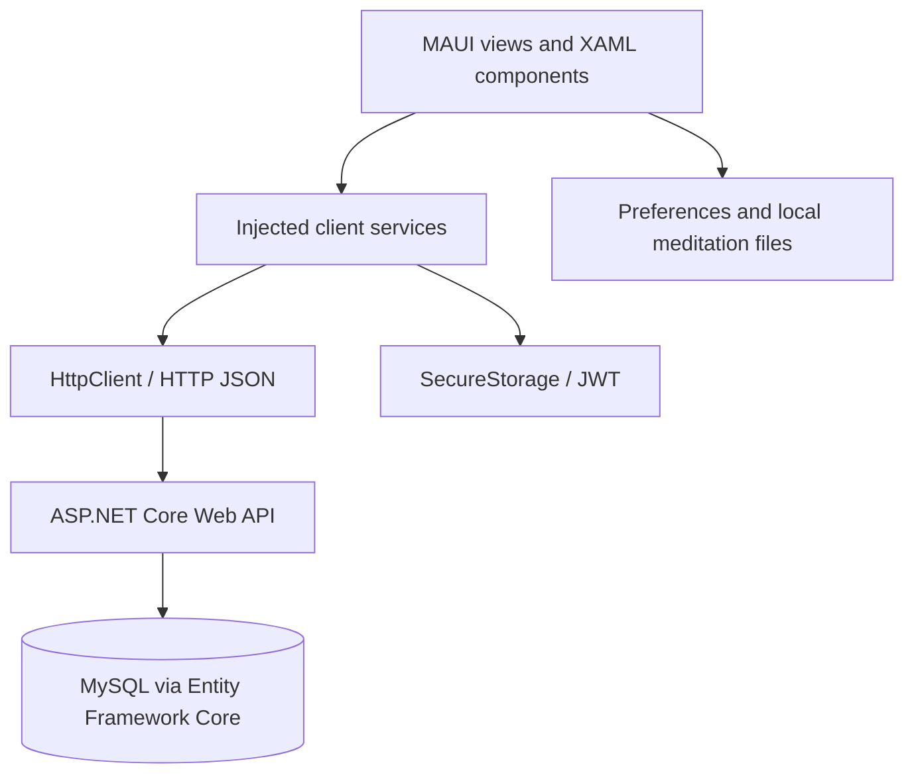

# Różańcowy Szlak — .NET MAUI Application

A cross-platform application for Rosary communities and parishes, built with **C# and .NET MAUI**. It combines daily Rosary meditations with group membership, messages, and administrative tools. The application communicates with a separate ASP.NET Core REST API.

**Related backend repository:** [D0MINoX/WebAPI](https://github.com/D0MINoX/WebAPI)

> **Portfolio note:** This repository contains the client application. User accounts, parish/group data, and messaging depend on an external backend; the mobile application is not a standalone offline service.

## Technology stack

| Area | Technologies |
| --- | --- |
| Language / UI | C#, .NET 10, .NET MAUI, XAML |
| Supported project targets | Android, iOS, Mac Catalyst, Windows (Windows target on Windows hosts) |
| API communication | `HttpClient`, REST API, HTTP/JSON, asynchronous methods |
| Authentication | JWT Bearer tokens, `SecureStorage` |
| App structure | Dependency Injection, service classes, Shell navigation, reusable XAML components |
| Local data | `Preferences`, files stored in `FileSystem.AppDataDirectory` |
| User experience | `CommunityToolkit.Maui`, custom themes, local notifications |
| Automation | GitHub Actions — iOS build workflow |

## Features

### Daily meditations and Rosary content
- Browse Rosary mysteries and daily meditations.
- Display formatted meditation content in a `WebView`.
- Save and retrieve meditation content locally for offline reading; download behavior is configurable in the application settings.
- Keep selected content and user preferences between sessions.
- Switch between light/dark appearance and themes associated with Rosary mysteries.

### Accounts and community membership
- Register, log in, update profile details and password, or log out.
- Store the login JWT in platform `SecureStorage`; attach it to authorized API requests.
- Browse parishes and Rosary groups and request membership.
- Access different screens depending on the user's role and available permissions.

### Communication
- Read and create messages within a Rosary group through the backend API.
- Fetch external members' phone numbers when the user's permissions allow it.
- Prepare SMS messages using the operating system's native SMS composer. **SMS sending requires user interaction**; the application does not silently send texts.
- Configure scheduled **local** reminders through `Plugin.LocalNotification` (these are not remote push notifications).

### Administration
- Review users and verify group membership.
- Manage Rosary groups and parishes.
- Update user roles and permissions.
- Manage external members and phone numbers.
- Submit error reports and provide an administrative view for their handling.

## Application architecture



The client uses dedicated service classes such as `AuthService`, `RosaryService`, `ParishService`, `MessagesService`, `MeditationsService`, `AdminService`, and `ErrorService`. These services are registered in `MauiProgram.cs` and used by application pages through dependency injection. The project uses both XAML with code-behind and selected reusable components; it should not be described as a fully MVVM-based codebase.

## Repository structure

```text
.
├── .github/
│   └── workflows/
│       └── ios-build.yml         # iOS CI build
├── MauiApp1.slnx
├── global.json                   # .NET SDK/workload selection
└── MauiApp1/
    ├── MauiApp1.csproj
    ├── MauiProgram.cs            # MAUI setup, API base URL, DI
    ├── AppShell.xaml(.cs)        # Navigation
    ├── Views/                    # Application pages
    ├── Components/               # Reusable popups and UI components
    ├── Services/                 # API client and app services
    ├── Models/                   # Client-side data models
    ├── Controls/                 # Custom controls
    ├── Resources/Styles/         # Themes and styling
    └── Platforms/                # Platform-specific configuration
```

## Getting started

### Prerequisites

- A compatible **.NET 10 SDK** and .NET MAUI workloads; `global.json` specifies SDK `10.0.100` with `latestFeature` roll-forward and pins a workload version.
- An IDE and platform tooling suitable for your target (for example, Visual Studio with .NET MAUI support and an Android SDK/emulator).
- For iOS/Mac Catalyst builds, a compatible macOS/Xcode environment; deploying iOS apps to devices can additionally require signing/provisioning.
- A running, compatible ASP.NET Core backend, or access to an existing backend environment.

### Clone and restore

```bash
git clone https://github.com/D0MINoX/aplikacja_roza.git
cd aplikacja_roza
dotnet workload restore MauiApp1/MauiApp1.csproj
dotnet restore MauiApp1/MauiApp1.csproj
```

### Configure the API

The API base URL is currently set in `MauiApp1/MauiProgram.cs`:

```csharp
string baseAddress = "https://api.rosaryapi.pl";
```

To use your own backend, change the base URL to the address of your compatible API deployment. The backend implementation is available in [D0MINoX/WebAPI](https://github.com/D0MINoX/WebAPI). When testing locally, remember that `localhost` on a phone or Android emulator is not necessarily your development computer; adjust networking and HTTPS certificate trust accordingly.

### Build for Android

```bash
dotnet build MauiApp1/MauiApp1.csproj -f net10.0-android
```

Open `MauiApp1.slnx` in a compatible IDE to select an emulator/device and run the application. Builds for iOS, Mac Catalyst, and Windows require their respective platform toolchains and host environment.

> The commands document how the project is configured; they are **not** a claim that a clean checkout has been tested on every supported target. Some functions require a live backend and an authenticated account.

## GitHub Actions

The workflow in [`.github/workflows/ios-build.yml`](.github/workflows/ios-build.yml) is triggered by pushes to `main`/`master` and can also be started manually. It uses a macOS runner, installs .NET 10, restores workloads, runs an iOS Release publish, and uploads matching IPA artifacts when generated.

The workflow disables code signing in its publish options. A produced artifact should therefore **not** be assumed to be ready for App Store distribution or installation on a physical device without additional signing and provisioning.

## Privacy and implementation notes

- JWTs are kept on the device using `SecureStorage`; the server is responsible for actual authentication and authorization enforcement.
- SMS functionality invokes the native composer, so message delivery is handled outside the app.
- Local reminders run on the user's device and do not require a push notification server.
- The backend URL is currently configured in source; a more configurable environment-specific setup would simplify local development.
- The repository does not currently include a dedicated automated test project. Adding tests and a documented demonstration environment would make it easier to review and reproduce the application.

## Future improvements

- Add representative screenshots or a short feature demo to this README.
- Add automated tests for client services and key application flows.
- Externalize the API base URL for development, staging, and production.
- Document supported platforms with verified setup/build instructions for each target.
- Improve error handling and offline synchronization behavior.

## Related repository

**ASP.NET Core backend:** [D0MINoX/WebAPI](https://github.com/D0MINoX/WebAPI)

---

**Project type:** educational / portfolio application developed with .NET MAUI and an external ASP.NET Core API.
